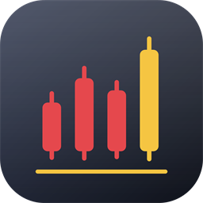
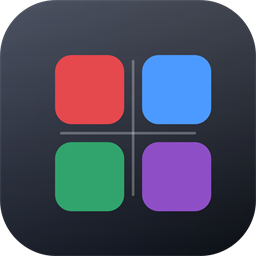

# DSH 模式面板

给 [DeepSeek Harness](https://github.com/deepseek-ai) 桌面版做的一套**模式启动器**：
桌面上点一下，就切换到对应的插件集合；还有个可视化面板可以勾选插件、自建模式。

**不用关程序、不用重开**，切换约 1 秒热生效。





## 这是解决什么问题的

DSH 桌面版只能跑 `profiles\desktop` 这一个 profile，启动参数里塞不进「模式」。
如果你的 profile 装了一堆股票插件，写代码或学东西时它们全都在线，会一直占着侧边栏、往工具列表里塞一堆用不到的东西。

这个项目用一条很窄的路子解决：**先改 profile 的插件清单，再把程序拉起或唤起**。
因为 DSH 的 `dsh-hmr` 在 watch 那几个文件，改完大约 1 秒内自动重新组合插件树——所以这不是「先改配置再重启」，是**热切**。

## 内置的五个模式

| 模式 | 做什么 |
| --- | --- |
| **股票** | 股票插件全部启用：盯盘、投研、账本 |
| **学习** | 股票插件全部关闭，其余插件照常 |
| **专注** | 学习 + 关掉皮肤、挂件这些装饰 |
| **编程** | 关股票、关挂件，保留文件树与工具管理 |
| **极简** | 只剩会话本身 |

模式定义在 `modes.json` 里，随便改、随便加。默认只有**股票**和**学习**两个会放到桌面（`pin` 字段控制），其它在面板里选。

## 三个入口怎么配合

| 图标 | 做什么 |
| --- | --- |
| **DSH 股票** | 切到股票模式 |
| **DSH 学习** | 切到学习模式 |
| **DSH 模式面板** | 打开可视化面板：勾选插件、改模式、新建模式 |
| **DeepSeek Harness**（原来那个） | 保持原样，当「全部开」的另一个入口 |

DSH 是单实例的：第二次点图标不会开新窗口，只会把已有窗口叫到前面，同时把插件集换成对应模式。

## 安装

需要：Windows、Windows PowerShell 5.1（系统自带）、DSH 桌面版装过并且至少启动过一次。

```powershell
git clone https://github.com/cuteFxt/dsh-mode-launcher.git
cd dsh-mode-launcher
powershell.exe -NoProfile -ExecutionPolicy Bypass -File .\install.ps1
```

它只做一件事：检查环境，然后在桌面创建快捷方式。不改系统别的地方。

只想看环境检查结果、不建图标：

```powershell
powershell.exe -NoProfile -ExecutionPolicy Bypass -File .\install.ps1 -CheckOnly
```

删掉快捷方式：

```powershell
powershell.exe -NoProfile -ExecutionPolicy Bypass -File .\install.ps1 -Uninstall
```

`-Uninstall` 只删「Target 是 `wscript.exe` 且参数指向本目录」的快捷方式，不会误删你自己的图标。

## 模式面板

点「DSH 模式面板」，或者在目录里直接跑：

```powershell
powershell.exe -NoProfile -ExecutionPolicy Bypass -File .\dsh-mode-panel.ps1
```

左边是模式列表，右边是当前模式的编辑器：

- 改名字、说明、工作区路径、标识色
- 按插件分组勾选——**勾上 = 开，取消 = 关**
- 「全开 / 全关 / 反选」批量操作
- 「在桌面放图标」决定这个模式要不要出现在桌面
- 「＋ 新建模式」建自定义模式，从当前选择复制
- 「保存」只写 `modes.json`；「应用并启动」保存 + 切换 + 拉起 DSH

面板顶部有「重新扫描插件」，装了新插件后点一下就能看到（结果缓存 12 小时，在 `catalog.json`）。

## 命令行也行

```powershell
# 列出所有模式（* 表示当前生效的）
powershell.exe -NoProfile -ExecutionPolicy Bypass -File .\dsh-mode.ps1 -ListModes

# 切到某个模式
powershell.exe -NoProfile -ExecutionPolicy Bypass -File .\dsh-mode.ps1 -Mode study

# 只改文件，不启动程序（适合验证）
powershell.exe -NoProfile -ExecutionPolicy Bypass -File .\dsh-mode.ps1 -Mode study -NoLaunch
```

注意 `-Mode` 收的是**模式 id**（`modes.json` 里的 `id` 字段），不是显示名。

## 主程序位置

脚本**自动探测** DSH 在哪，顺序是：

1. `dsh-mode.config.psd1` 里的 `ExePath`
2. 环境变量 `DSH_EXE`
3. 正在运行的 `DeepSeek Harness` 进程
4. 桌面 / 开始菜单里名字含 `DeepSeek Harness` 的快捷方式

都找不到时，复制 `dsh-mode.config.example.psd1` 为 `dsh-mode.config.psd1`，把 `ExePath` 填上即可。

## 文件说明

```
.
├─ install.ps1                    安装 / 卸载快捷方式，附带环境检查
├─ dsh-mode.vbs                   模式入口（wscript 调用，保证不闪黑框）
├─ dsh-mode.ps1                   命令行：切到某个模式
├─ dsh-mode-panel.vbs             面板入口（同上，静默）
├─ dsh-mode-panel.ps1             可视化面板（WPF）
├─ dsh-modes-lib.ps1              共享逻辑：读写、切换、快捷方式同步
├─ modes.json                     模式清单（可编辑）
├─ make-icons.ps1                 图标生成脚本（想改配色改这个再跑一遍）
├─ dsh-mode.config.example.psd1   可选配置模板
└─ icons\
   ├─ dsh-stock.ico               股票图标（16/24/32/48/64/128/256 七种尺寸）
   ├─ dsh-study.ico               学习图标
   ├─ dsh-panel.ico               面板图标
   └─ preview-*.png               预览图
```

首次运行后会生成 `catalog.json`（插件目录缓存）和 `modes.state.json`（上次应用的状态），两个都在 `.gitignore` 里。

## 它到底改了什么

改动三处，都是原子写入（临时文件 + 改名），改前自动备份成 `.bak-时间戳`，只留最近 8 份。

### 1. `cordis.patch.yml`

被勾掉的插件，在补丁文件里写一个两行的块：

```yaml
- id: dsh-plugin-stock-x
  disabled: true
```

勾回来的就删掉这块。脚本每次都会**先读补丁文件当前状态**再决定放开什么，所以手动改过、或者从别人的模式切过来，都能自愈（不会出现「该开的没开回来」）。

> **改 patch 必须用「行 id」而不是「包名」**，两者经常不一样。
> 比如包 `dsh-stock-analysis` 的行 id 是 `stock-analysis`，包 `dsh-ths-holdings` 会插出 `ths-holdings` 和 `ths-holdings-skill` 两行。
> 面板会自动从每个包的 `cordis.patch.yml` 里把这些行 id 抽出来，不用你记。

基础设施行（`llm-*`、`session*`、`storage*`、`agent*`、`sandbox`、`fs-*` 等）受保护，就算配错了也不会被关。被跳过的会写进日志。

### 2. `package.json` 的 `dsh.profile.bundles`

有些插件是作为 **bundle** 装的（整个包进 profile 的组合列表），它们自带 `- insert:`，光写 `disabled` 行不够。
所以模式里可以用 `requireBundles` / `removeBundles` 声明要加减的 bundle，脚本会原子改写这个数组、保持缩进和逗号。

不写这两个字段就完全不碰 `package.json`——默认的五个模式里只有 `dsh-ths-holdings` 会用到。

### 3. `.dsh-market\state.json`

同步维护插件市场的「已禁用」列表，免得市场面板显示与实际不一致。
这个文件的键是**包名**（又和 patch 的行 id 不一样），两边各自维护。

<p><small>这一步是纯字符串层面的增删，不走 `ConvertFrom-Json` / `ConvertTo-Json` 往返——PS 5.1 那样往返会把中文键（分组名「股票」「日常」）写坏。</small></p>

写入铁律：**UTF-8 无 BOM + LF**。用 PowerShell 的 `Set-Content` 会写 BOM 和 CRLF，DSH 那边可能读不对，所以脚本里全是 `[System.IO.File]::WriteAllText` + `UTF8Encoding($false)`。

## 为什么不用重启

DSH 的 `dsh-hmr` 服务在 watch `cordis.patch.yml` 和 `package.json`，每 500ms 轮询一次文件内容，变了就重新组合插件树。失败只 warn，不会让 Host 崩。

实测（切到学习模式后立刻查询）：股票查询工具从工具列表里消失，`ths-portfolio-report` 技能也一起消失；切回来又都回来。**全程进程没重启过**，7 个进程的 StartTime 一直没变。

## 已知限制

**工作区不会自动切。** 活动工作区存在渲染进程的 selection store 里，后端 `storages\` 目录下没有对应的域，外部脚本没法指定。
`modes.json` 里的 `workspace` 字段目前只是**备注**（面板里能看到这个模式建议用哪个工作区），点完图标后工作区还是上次那个，需要手动切一下。

如果以后 DSH 支持了 `--workspace` 之类的启动参数，改 `dsh-modes-lib.ps1` 里 `Start-DshApp` 那一行就行。

**「学习模式」目前是纯减法。** 它只做「关掉股票插件」，并不会主动开启什么学习专用插件——因为 profile 里目前一个学习专用插件都没有。
以后装了，在面板里勾一下就有了；命令行的话在 `modes.json` 里把包名从对应模式的 `disabled` 里去掉即可。

## 故障排查

看脚本目录下的 `dsh-mode.log`，每次运行追加一段：

```
[2026-11-07 10:31:33] [stock] ==== 开始切换 (NoLaunch=False) ====
[2026-11-07 10:31:33] [stock] 已改写：cordis.patch.yml、package.json、.dsh-market\state.json
[2026-11-07 10:31:33] [stock] 已拉起 / 唤起：D:\deepseek\DeepSeek Harness.exe
[2026-11-07 10:31:33] [stock] ==== 完成 ====
```

从备份恢复：

```powershell
$dir = Join-Path $env:USERPROFILE '.dsh\profiles\desktop'
Get-ChildItem $dir -Filter 'cordis.patch.yml.bak-*' | Sort-Object Name -Descending | Select-Object -First 5
Copy-Item "$dir\cordis.patch.yml.bak-20261107-103133" "$dir\cordis.patch.yml" -Force
```

### 点图标没反应

脚本用 `wscript` 静默跑，出错不弹窗，只会写日志。先看 `dsh-mode.log` 最后几行。

### 中文日志乱码

`.ps1` 文件必须存成 **UTF-8 带 BOM**。Windows PowerShell 5.1 读无 BOM 的 UTF-8 会按 GBK 解码。
`install.ps1` 会检查这一点并提醒。用编辑器改完脚本记得确认 BOM 还在。

### 面板里插件数量不对

点「重新扫描插件」。如果新装的插件还是没出现，说明它没有 `dsh.bundle.patch`——面板只列带 bundle patch 的包。

## 自定义

改图标配色：编辑 `make-icons.ps1` 顶部的颜色常量，然后

```powershell
powershell.exe -NoProfile -ExecutionPolicy Bypass -File .\make-icons.ps1
```

它会重画七种尺寸并打包成 ICO，同时在 `icons\` 下留预览 PNG。

图标是纯 GDI+ 画的（4 倍超采样再缩），不依赖 ImageMagick 或任何第三方库。

## License

MIT
